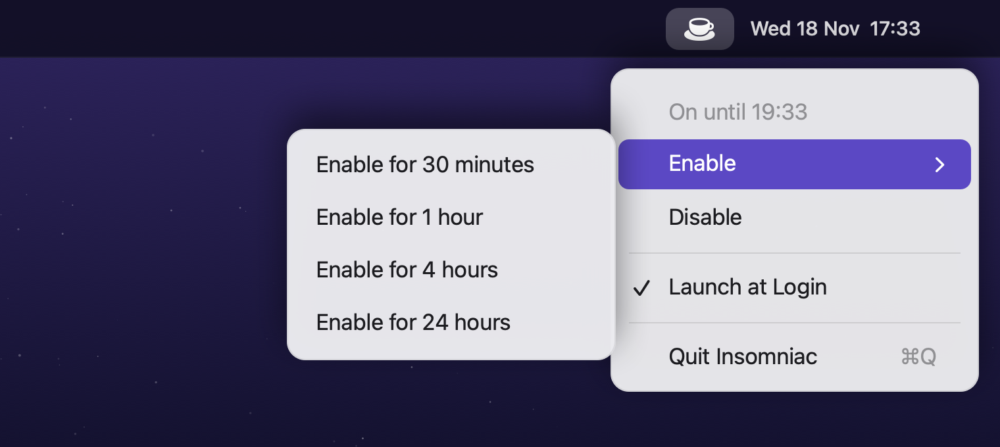

# Insomnimac

A tiny macOS menu bar app that keeps your Mac awake, **even with the lid closed**.



## Features

- Lives in the menu bar (no Dock icon): 🌙 when off, ☕ when on
- **Enable ▸** submenu: 30 minutes, 1 hour, 4 hours, or 24 hours; turns itself off when time is up
- **Disable** to turn it off early
- Status line shows whether it's on and when it will turn off
- **Launch at Login** option
- Quitting the app always restores normal sleep

## Install

Requires macOS 13+ and the Xcode Command Line Tools (`xcode-select --install`).

```sh
git clone https://github.com/oskob/insomnimac.git && cd insomnimac && sh install.sh
```

`install.sh` compiles the app, installs it to `/Applications/Insomnimac.app`, and launches it. Run it again any time to rebuild and reinstall.

## First use

The first time you enable it, macOS asks for your admin password **once**. Insomnimac then installs a narrow sudoers rule at `/etc/sudoers.d/insomnimac` that allows your user to run exactly these two commands without a password:

```
/usr/bin/pmset -a disablesleep 1
/usr/bin/pmset -a disablesleep 0
```

After that, toggling is instant.

## How it works

Normal "keep awake" tools (like `caffeinate` or power assertions) can't stop clamshell sleep when the lid closes, unless an external display is connected. The only reliable way is `pmset disablesleep`, which requires root, hence the one-time sudoers rule. While enabled, Insomnimac also holds a power assertion to stop idle sleep with the lid open (the display may still turn off).

## ⚠️ Caution

A Mac running with the lid closed in a bag can get hot and drain the battery quickly. Turn Insomnimac off before packing up.

## Uninstall

```sh
osascript -e 'quit app "Insomnimac"'   # restores normal sleep
rm -rf /Applications/Insomnimac.app
sudo rm /etc/sudoers.d/insomnimac
```

If you had Launch at Login enabled, turn it off from the menu first, or remove it under System Settings → General → Login Items.
